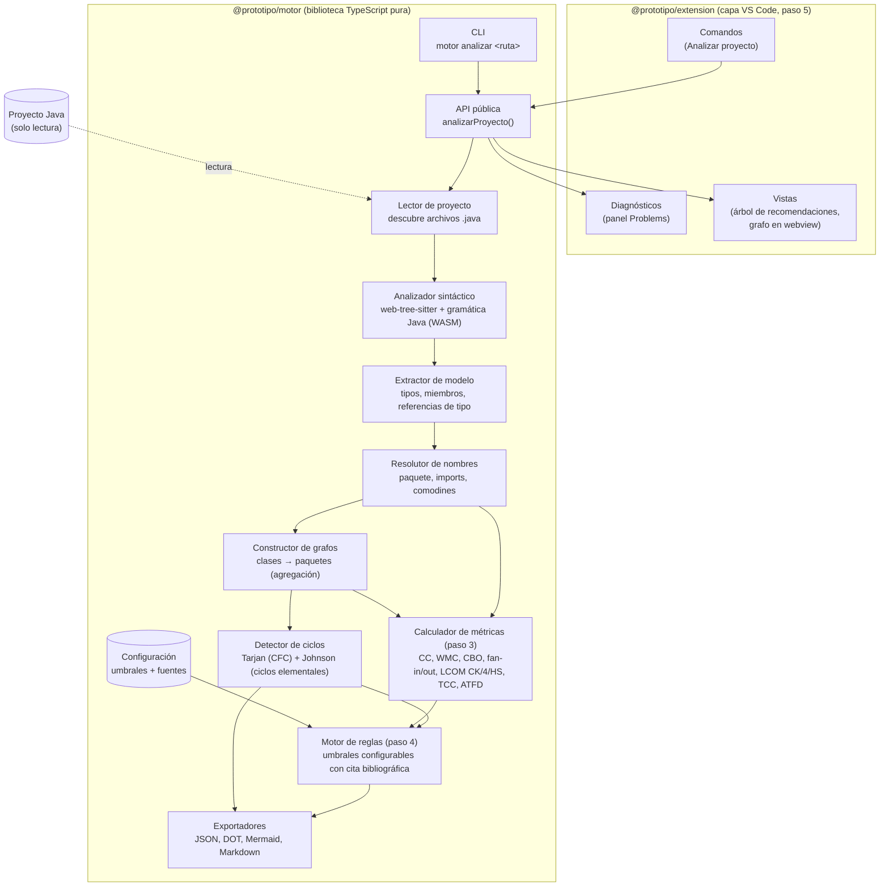
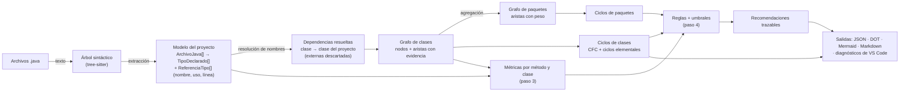
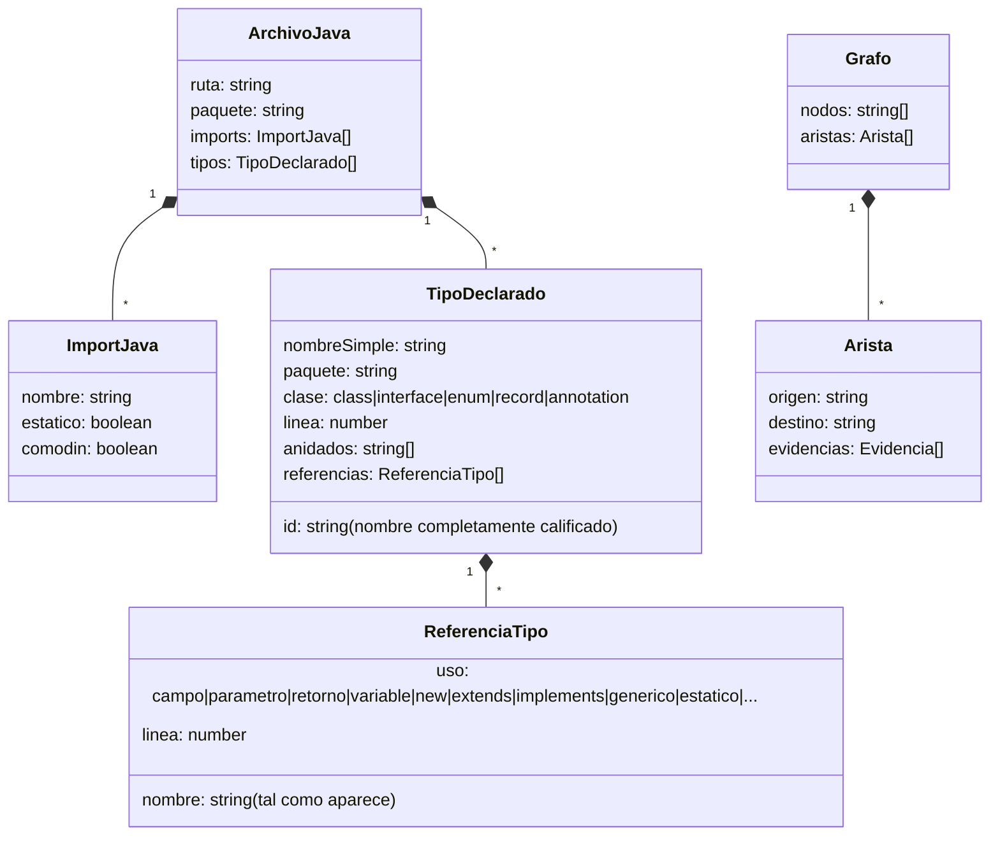

# Arquitectura del prototipo (objetivo específico 2)

Este documento describe la arquitectura de la extensión de VS Code para el análisis estructural de proyectos Java. Los diagramas usan Mermaid: se ven directamente en VS Code y en GitHub, y se pueden exportar a SVG/PNG con `mermaid-cli` para insertarlos en la tesis.

## 1. Principios de diseño

| Principio | Cómo se aplica |
|---|---|
| Separación motor / presentación | El **motor** es una biblioteca TypeScript pura, sin dependencia de la API de VS Code. Se ejecuta y se prueba desde la línea de comandos. La **extensión** es una capa delgada que invoca al motor y muestra resultados. |
| Solo lectura | Ningún componente escribe en el proyecto analizado. La extensión solo muestra diagnósticos, vistas y reportes. |
| Determinismo | Sin IA ni servicios externos. Con la misma entrada y la misma configuración se obtiene la misma salida (los nodos, aristas y ciclos se ordenan de forma canónica). |
| Trazabilidad | Cada arista del grafo guarda su evidencia (tipo de uso y línea). Cada recomendación (paso 4) guardará el problema, la métrica, el valor medido, el umbral excedido con su cita y la refactorización sugerida. |
| Pipeline por etapas | Cada etapa produce una estructura de datos intermedia serializable. Eso permite probar cada etapa por separado y guardar su salida como evidencia. |

## 2. Diagrama de componentes



## 3. Flujo de datos



## 4. Modelo de datos intermedio



## 5. Decisiones de diseño del grafo (paso 2)

1. **Nodo = tipo de nivel superior** (clase, interfaz, enum, record o anotación declarados directamente en un archivo). Los tipos anidados, las clases anónimas y las lambdas se integran en el tipo de nivel superior que los contiene. Así se evitan ciclos espurios Externa↔Interna, que son inherentes a Java y no indican un problema de diseño.
2. **Arista A → B** si A referencia el nombre de B en alguno de estos usos: tipo de campo, parámetro, retorno, variable local, `new`, `extends`/`implements`, argumento genérico o cota de tipo, `catch`, `throws`, cast, `instanceof`, literal de clase (`B.class`), anotación, referencia a método (`B::m`), acceso estático (`B.metodo()`, `B.CONSTANTE`) o `import static`. Se excluyen las autorreferencias.
3. **Los imports normales no generan aristas por sí solos**: solo sirven para resolver nombres. Así un import sin usar no crea una dependencia falsa.
4. **Tipos externos** (JDK y bibliotecas): se descartan. Solo son nodos los tipos declarados en el proyecto.
5. **Grafo de paquetes**: se obtiene agregando las aristas de clases entre paquetes distintos. El peso es el número de aristas de clases que se agregaron.
6. **Ciclos**: se usa el algoritmo de Tarjan (1972) para los componentes fuertemente conexos (CFC). Todo CFC de tamaño > 1 contiene al menos un ciclo. El algoritmo de Johnson (1975) enumera los ciclos elementales. Como el número de ciclos puede crecer de forma exponencial, la enumeración tiene un límite configurable, y si se alcanza se marca como `truncado`.

## 6. Resolución de nombres (sin resolución de tipos)

tree-sitter solo entrega sintaxis. Un nombre simple `N` que aparece en un tipo `T` del paquete `P` se resuelve en este orden, siguiendo las reglas de alcance de la JLS §6.4.1:

1. un tipo anidado dentro de `T` (autorreferencia, se ignora);
2. un import de tipo único cuyo último segmento sea `N`;
3. un tipo del mismo paquete `P` llamado `N`;
4. imports a demanda (`import p.*;`) → `p.N`, si existe en el proyecto;
5. en cualquier otro caso es externo (por ejemplo, `java.lang`) y se descarta.

Los nombres calificados (`a.b.C`, `Externa.Interna`) se buscan como nombre completo y, si no se encuentran, se resuelve su primer segmento como nombre simple. El acceso estático `X.m()` solo se cuenta si `X` empieza con mayúscula, no coincide con el nombre de ninguna variable, parámetro o campo declarado en `T` y se resuelve a un tipo del proyecto.

### Limitaciones (declarar en la tesis)

- **`var`** y tipos que solo aparecen en **llamadas encadenadas** (`a.getB().metodo()`): el tipo intermedio no se ve, así que no hay arista si `B` no se nombra en otra parte de la clase.
- **Tipos miembro heredados** usados por nombre simple sin import: no se resuelven.
- **Acceso estático con nombre completamente calificado** (`com.x.Util.m()`): no se detecta.
- **Ambigüedad entre imports a demanda**: si dos imports `*` contienen el mismo nombre simple, se toma el primero.
- **Parámetros de tipo** (`<T>`): se excluyen por nombre dentro del tipo de nivel superior completo, lo cual es una aproximación de su alcance real.
- **Reflexión, inyección de dependencias por configuración y carga dinámica**: no se ven (análisis puramente estático).

## 7. Convenciones de las métricas (paso 3)

| Métrica | Definición en el motor | Fuente |
|---|---|---|
| CC (por método) | 1 + `if`, `for`, for-each, `while`, `do`, `case` (no `default`), `catch`, `?:`, `&&`, `\|\|`. Las lambdas cuentan para el método que las contiene; las clases anónimas y locales no. | McCabe 1976 |
| WMC | Suma de la CC de todos los métodos y constructores declarados en la clase. | Chidamber y Kemerer 1994 (ponderación con CC, como en Lanza y Marinescu 2006 y en el plugin Metrics) |
| Fan-out / fan-in | Clases del proyecto de las que depende / que dependen de ella (aristas del grafo del paso 2). | — |
| CBO | Tamaño de entrantes ∪ salientes. | Chidamber y Kemerer 1994 (versión bidireccional) |
| LCOM-CK | max(P − Q, 0) sobre pares de métodos que no son constructores. | Chidamber y Kemerer 1994 |
| LCOM4 | Componentes conexos de métodos, unidos si comparten un atributo o si uno llama al otro. | Hitz y Montazeri 1995 |
| LCOM-HS | (media de μ(A) − m) / (1 − m); null si no hay atributos o m < 2. | Henderson-Sellers 1996 |
| TCC | Pares de métodos que comparten un atributo (conexión directa) / total de pares. | Bieman y Kang 1995 |
| ATFD | Atributos distintos de otras clases del proyecto accedidos con `x.campo` o con accesores `x.getY()` / `x.isY()` sin argumentos. | Lanza y Marinescu 2006 |

Las métricas de cohesión excluyen los constructores e incluyen todos los atributos, también los estáticos. Un método "usa" un atributo cuando lo nombra (lectura o escritura) o escribe `this.atributo`, salvo que una variable local o un parámetro con el mismo nombre lo oculte.

### Limitaciones adicionales (declarar en la tesis)

- **Ocultamiento por variables locales:** se aproxima a nivel de todo el método, no de cada bloque.
- **ATFD:** el tipo del receptor se toma de la declaración de la variable o del campo. No se ven los receptores que son expresiones (`a.getB().getC()`), y la heurística de accesor se basa en el nombre (`get`/`is`), no en lo que el método hace realmente.
- **Clases anónimas, locales y anidadas:** sus métodos no se miden por separado ni suman a la clase contenedora.
- **Comparabilidad con otras herramientas:** los umbrales de `docs/umbrales.md` se derivaron con otras herramientas (Metrics, Connecta, PMD), cuyas implementaciones pueden diferir de esta.

## 8. Estructura del repositorio

```
Prototipo/
├─ package.json              (npm workspaces)
├─ packages/
│  ├─ motor/                 (@prototipo/motor: biblioteca + CLI, sin VS Code)
│  │  ├─ src/
│  │  │  ├─ proyecto.ts      lector de proyecto
│  │  │  ├─ parser.ts        inicialización de web-tree-sitter
│  │  │  ├─ sintaxis.ts      utilidades sobre el árbol sintáctico
│  │  │  ├─ extractor.ts     árbol sintáctico → modelo
│  │  │  ├─ miembros.ts      atributos y métodos (CC, uso de atributos, accesos ajenos)
│  │  │  ├─ metricas.ts      WMC, CBO, fan-in/out, LCOM CK/4/HS, TCC, ATFD
│  │  │  ├─ resolutor.ts     nombres → tipos del proyecto
│  │  │  ├─ grafo.ts         grafo de clases y de paquetes
│  │  │  ├─ ciclos.ts        Tarjan + Johnson
│  │  │  ├─ exportar.ts      JSON, DOT, Mermaid, Markdown
│  │  │  ├─ analizar.ts      orquestación del pipeline
│  │  │  └─ cli.ts
│  │  └─ test/               pruebas Vitest contra docs/caso-prueba-esperado.md
│  └─ extension/             (@prototipo/extension: paso 5)
├─ tests/fixtures/           proyectos Java de prueba
└─ docs/
   ├─ arquitectura.md        este documento
   ├─ caso-prueba-esperado.md
   └─ evidencia/             salidas de cada paso para el cap. 8
```
